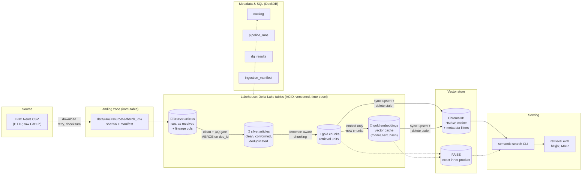
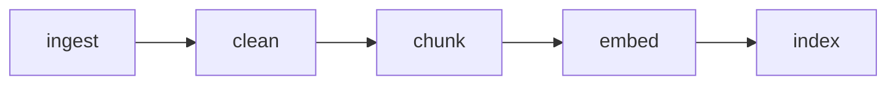

# Data Engineering: from raw text to vectors

An end-to-end, runnable data engineering project. It takes a public news dataset from a raw HTTP
source all the way to a searchable **vector store**, through a **Delta Lake lakehouse** with a
medallion architecture (bronze, silver, gold), data-quality gates, a table catalog, SQL access,
incremental embeddings and retrieval evaluation.

Everything runs locally on a laptop. There are **no paid APIs and no API keys**.

```bash
pip install -e ".[dev,neural]"     # or `make install` for the dependency-light version
de-pipeline run                    # ingest -> clean -> chunk -> embed -> index  (~20 s)
de-pipeline search "rising oil prices hurt airline profits"
```

---

## Architecture



Orchestration: each stage is an **idempotent function** `(config, run_id) -> metrics`. The bundled
CLI runs them as a DAG, and [`orchestration/airflow_dag.py`](orchestration/airflow_dag.py) wraps
the very same functions as Airflow tasks with retries.



## The lakehouse

| Layer | Table | Grain | Write pattern | What happens |
|---|---|---|---|---|
| Landing | `data/raw/...` | one file per batch | write-once | Raw bytes kept immutably, sha256-fingerprinted, logged in `ingestion_manifest` |
| 🥉 Bronze | `bronze.articles` | one row per source record | **append** | Data exactly as received (all strings) plus `source`, `batch_id`, `source_sha256`, `ingested_at` lineage |
| 🥈 Silver | `silver.articles` | one row per unique article | **MERGE** on `doc_id` (updates only when content changed) | Encoding repair, Unicode normalisation, title/body parsing, label conforming, filtering, dedup, derived features, **DQ gate** |
| 🥇 Gold | `gold.chunks` | one row per chunk | overwrite (fully derived) | Sentence-aware overlapping chunks, title-enriched text for embedding, deterministic `chunk_id` |
| 🥇 Gold | `gold.embeddings` | one row per (model, text) | **MERGE** on `embedding_key` | Content-addressed embedding cache. Re-runs embed only new or changed chunks |

**Why Delta Lake?** It is an open table format on plain Parquet that gives ACID commits, schema
enforcement, `MERGE` upserts and **time travel**. It's written here with
[delta-rs](https://github.com/delta-io/delta-rs), so there's no Spark or JVM to run locally. The
same tables can be read by Spark, Databricks, Trino or DuckDB.

**Catalog:** every table write registers the table (layer, location, format, version, row count,
schema and description) in a `catalog` table, the way Unity Catalog, Glue or Hive Metastore would.

```text
$ de-pipeline catalog
table            format  version  rows  description
---------------  ------  -------  ----  -----------------------------------------------------------
bronze.articles  delta   0        2225  Raw articles exactly as received, one row per source record...
silver.articles  delta   0        2091  Cleaned, conformed and deduplicated articles (one row per u...
gold.chunks      delta   0        6074  Retrieval units: sentence-aware overlapping chunks of silve...
gold.embeddings  delta   0        6024  Embedding cache keyed by (model_id, text_hash); vectors are...
```

**SQL over the lakehouse** uses DuckDB as the query engine. Each table is exposed as `<layer>_<table>`:

```text
$ de-pipeline sql "SELECT category, count(*) docs, round(avg(word_count)) avg_words
                   FROM silver_articles GROUP BY 1 ORDER BY 2 DESC"
category       docs  avg_words
-------------  ----  ---------
business       500   323.0
sport          493   322.0
politics       395   453.0
entertainment  366   328.0
tech           337   512.0
```

**Time travel and audit** come from Delta's commit log:

```text
$ de-pipeline history silver.articles
version  timestamp_utc        operation  metrics
-------  -------------------  ---------  ------------------------------------------------
1        2026-11-21 16:06:59  MERGE      {"num_source_rows": 2091, "num_target_rows_inserted": 0, ...
0        2026-11-21 16:05:56  WRITE      {"num_added_files": 1, ...
```
```python
from de_pipeline import lakehouse
from de_pipeline.config import load_config
lakehouse.read_table(load_config(), "silver", "articles", version=0)   # read an older snapshot
```

## Pipeline stages

### 1. Ingestion ([`stages/ingest.py`](src/de_pipeline/stages/ingest.py))
- Streaming HTTP download with timeout and **exponential-backoff retries**. Writes go to a `.part` file and are renamed atomically.
- The file is **sha256-fingerprinted**. If the same content was already loaded, the batch is skipped, so re-running never double-loads.
- **Mixed-encoding handling:** the source file is mostly UTF-8 but contains stray cp1252 bytes. A custom codec error handler decodes each invalid byte as cp1252 instead of dropping or replacing it.

### 2. Cleaning and transformation ([`stages/clean.py`](src/de_pipeline/stages/clean.py))
- Repairs **mojibake** (`£3.2bn` becomes `£3.2bn`), applies Unicode NFKC, strips control characters and normalises whitespace and paragraphs.
- Parses semi-structured text into `title` and `body`, and conforms labels (`" TECH "` becomes `tech`).
- Filters junk and **deduplicates** on a content hash. The raw dump has **134 duplicate articles** out of 2,225.
- Derives `word_count`, `char_count`, `paragraph_count` and a deterministic `doc_id`.

### 3. Data-quality gate ([`quality.py`](src/de_pipeline/quality.py))
A small declarative check library in the style of Great Expectations or dbt tests: `not_null`, `unique`,
`accepted_values`, `min_length`, `row_count_between` and `no_encoding_artifacts`. Error-severity
failures **abort the run before bad data reaches silver**, and every result is persisted to `dq_results`.

```text
DQ [silver.articles] unique:doc_id               PASS (observed=0)
DQ [silver.articles] accepted_values:category    PASS (observed=ok)
DQ [silver.articles] no_encoding_artifacts:body  PASS (observed=0)
```

### 4. Chunking ([`stages/chunk.py`](src/de_pipeline/stages/chunk.py))
A sentence-aware, token-budgeted sliding window, written from scratch with no LangChain:
- Chunks never cut a sentence in half. Only a single sentence over the budget gets hard-split.
- Consecutive chunks share about 40 tokens of whole sentences, so facts on a boundary can be found from either side.
- Tiny tail chunks are merged into the previous chunk.
- **Contextual enrichment:** the article title is prepended to the text that gets embedded.
- Result: 2,091 articles become **6,074 chunks** (median 165 tokens, p95 179).

### 5. Embeddings ([`embedders.py`](src/de_pipeline/embedders.py), [`stages/embed.py`](src/de_pipeline/stages/embed.py))
| Backend | Model | Dim | Notes |
|---|---|---|---|
| `sentence-transformers` (default with `[neural]`) | `all-MiniLM-L6-v2` | 384 | Neural, runs on CPU, downloads once from Hugging Face |
| `lsa` (automatic fallback) | TF-IDF (1-2 grams) + TruncatedSVD | 256 | Classic, fully offline, fitted on the corpus and persisted |

- Vectors are L2-normalised, so inner product equals cosine similarity.
- Embeddings are **content-addressed** by `(model_id, sha256(text))`. Re-runs embed only new or changed chunks, and switching models keeps both vector sets.
- The chosen model is persisted so queries are always embedded with the same model as the corpus.

### 6. Vector store ([`vectorstores.py`](src/de_pipeline/vectorstores.py), [`stages/index.py`](src/de_pipeline/stages/index.py))
- **ChromaDB** (default) is persistent, uses an HNSW index with cosine distance, and supports metadata filters (`--category tech`).
- **FAISS** uses an exact `IndexFlatIP` with a Parquet metadata sidecar.
- The store is **synchronised** with gold: current chunks are upserted, deleted chunks are removed, and the collection is rebuilt automatically if the embedding model changes.

## Semantic search demo

```text
$ de-pipeline search "rising oil prices hurt airline profits" -k 3

1. [0.824] (business) Oil prices fall back from highs
     Oil prices retreated from four-month highs in early trading on Tuesday after producers' cartel
     Opec said it was now unlikely to cut production...
2. [0.792] (business) Oil prices reach three-month low
3. [0.787] (business) Crude oil prices back above $50

$ de-pipeline search "new mobile phone technology" --category tech -k 3
1. [0.753] (tech) Mobiles rack up 20 years of use
2. [0.727] (tech) Finding new homes for old phones
...
```

## Retrieval evaluation

`de-pipeline eval` runs a self-supervised benchmark that needs no hand-labelled queries. It samples 200
articles, uses a sentence from the middle of each one as the query, and checks whether that article
comes back.

| Embeddings | Vector store | hit_rate@5 | MRR@5 | category precision@5 |
|---|---|---|---|---|
| LSA (256-d) | Chroma (HNSW, approximate) | 0.955 | 0.869 | 0.834 |
| LSA (256-d) | FAISS (exact) | 0.955 | 0.898 | 0.868 |

The gap between the two rows shows the trade-off between approximate (HNSW) and exact nearest-neighbour search.
Run it with `[neural]` installed to compare MiniLM against LSA on the same benchmark.

## Run it

**Locally**
```bash
python -m venv .venv && source .venv/bin/activate
make install-neural        # or: make install   (no torch; uses the LSA embedder)
make run
make search Q="interest rates and inflation"
make eval
make test
```

**Docker**
```bash
docker compose run --rm pipeline                         # full pipeline
docker compose run --rm pipeline search "election campaign"
docker compose run --rm pipeline sql "SELECT * FROM catalog"
```

**Useful commands**
```bash
de-pipeline run --stages chunk,embed,index    # re-run part of the DAG
de-pipeline runs                              # recent stage runs, status, durations
de-pipeline history gold.embeddings           # Delta commit log
DE_VECTOR_STORE__BACKEND=faiss de-pipeline run --stages index   # any config key via env
```

## Configuration

Everything is in [`config/pipeline.yaml`](config/pipeline.yaml): sources, cleaning rules, chunk
sizes, embedding backend and vector store. Any key can be overridden with an environment variable in
the form `DE_<SECTION>__<KEY>`. To add a source, append it under `sources:` (`http_csv` or
`local_csv`) and name its text and label columns.

## Project layout

```text
├── config/pipeline.yaml          # single source of configuration
├── src/de_pipeline/
│   ├── cli.py                    # de-pipeline run | search | eval | sql | catalog | history | runs
│   ├── pipeline.py               # DAG runner, run metadata
│   ├── lakehouse.py              # Delta tables, catalog, DuckDB SQL engine, metadata DB
│   ├── quality.py                # data-quality checks
│   ├── embedders.py              # sentence-transformers / LSA
│   ├── vectorstores.py           # Chroma / FAISS
│   ├── search.py                 # semantic search + evaluation
│   └── stages/                   # ingest, clean, chunk, embed, index
├── orchestration/airflow_dag.py  # same stages as an Airflow DAG
├── tests/                        # unit + end-to-end tests (fixture data, runs offline)
├── Dockerfile, docker-compose.yml, Makefile
└── .github/workflows/ci.yml      # pytest on every push
```

## Engineering principles shown here

- **Idempotent, re-runnable stages:** checksum-based ingestion, MERGE upserts, deterministic IDs and content-addressed caches.
- **Immutability and lineage:** raw files are never modified, and every bronze row knows its source file and batch.
- **Fail fast on bad data:** quality gates run before data is promoted to the next layer.
- **Observability:** per-stage metrics, durations and status in `pipeline_runs`, plus Delta commit history.
- **Pluggable components:** the source, embedding backend and vector store are each one config line.
- **Tested:** unit tests plus an end-to-end test that runs the whole pipeline on fixture data for both vector stores.

## Dataset

BBC News dataset: 2,225 articles in 5 categories (D. Greene and P. Cunningham, *Practical Solutions to
the Problem of Diagonal Dominance in Kernel Document Clustering*, ICML 2006). It is used here for
non-commercial, educational purposes and is downloaded at runtime, not redistributed.
